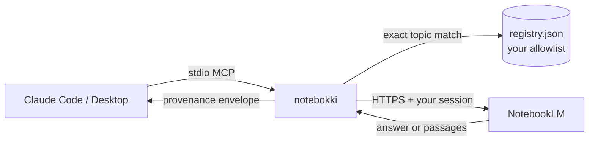

<div align="center">

<h1>
  
  notebokki
</h1>

**Ask your NotebookLM notebooks from inside Claude.**

A small, read-only MCP server that lets Claude Code and Claude Desktop look up a business rule
in your own NotebookLM notebooks, mid-task, instead of you reading a browser tab and relaying it by hand.

[Setup guide](docs/SETUP.md) &middot; [Use in any project](CLAUDE.BUSINESS-RULE.md) &middot; [Plan](docs/plans/2026-10-11-001-feat-notebokki-notebooklm-mcp-plan.md)

</div>

---

## Why

Business rules live in documents: requirement definitions, forms, meeting minutes. You put them in a
NotebookLM notebook. Then, while coding, you alt-tab to the browser, find the rule, and paste it to
Claude.

notebokki removes that step. Claude picks the right notebook, asks it, and gets back the answer
**with the name of the document it came from**, so a rule can be traced before you act on it.

```text
You:     Add validation for the equipment lending form.
Claude:  (looks up the lending rules in your notebook)
         The form requires lending destination, date, item name, and a serial/IMEI...
         Source: Lending Form_備品貸出書フォーム
```

## What you get

| Tool | Use it to | Returns | Typical time |
|---|---|---|---|
| `list_topics` | See which notebooks are registered | Topic names and descriptions | instant |
| `search` | Look up or quote a rule exactly | Matching source passages, **word for word** | 2-4 s |
| `ask` | Understand how a rule works | NotebookLM's synthesized answer, with source documents | 30-40 s |

Claude reads the topic descriptions you write and chooses the notebook itself. There is no fuzzy
matching: a wrong topic name fails loudly and lists the valid ones.

## How it works



- **You write the registry.** A JSON file mapping short topic names to notebook URLs and a
  description. It is the only list of notebooks notebokki can reach. It never enumerates your account.
- **Claude picks a topic** from those descriptions, then calls `search` or `ask`.
- **Results come back labelled.** Each result names the topic and its description, so a wrong-notebook
  answer is visible, and marks the text as untrusted reference material.

## Principles

- **Read-only.** No tool adds, edits, or removes a source, a notebook, or anything in it. (Asking does
  add a turn to the notebook's chat thread, exactly as typing in the web UI would.)
- **Pass-through.** NotebookLM's output is returned as-is. No second model, no general knowledge, no
  summarizing wrapper. If the notebook does not cover the question, you get that outcome.
- **Loud failure.** Four separate error messages: unknown topic, dead session, notebook unreachable,
  upstream problem. Each tells you a different fix.
- **Small trust surface.** No browser at query time, and no third-party server holds your Google
  session. The only external code in the credential path is one pinned library, `notebooklm-py`.

## Quick start

```bash
git clone <this repo> notebokki && cd notebokki
uv sync --locked
```

1. Write `~/.config/notebokki/registry.json`.
2. Capture a Google session and run `uv run notebokki setup --from-file <state.json>`.
3. Register it with Claude Code:

```bash
claude mcp add --scope user notebokki -- uv run --directory "$PWD" notebokki serve
```

Step-by-step instructions, including how to capture the session, are in **[docs/SETUP.md](docs/SETUP.md)**.

To make Claude reach for it on its own in any project, add one line to that project's `CLAUDE.md`
(or to `~/.claude/CLAUDE.md` for every project):

```markdown
@/absolute/path/to/notebokki/CLAUDE.BUSINESS-RULE.md
```

## Registry example

```json
{
  "asset-management": {
    "url": "https://notebooklm.google.com/notebook/<id>",
    "description": "Requirements for equipment lending and asset management: lending form, vehicle sublease contract, supplier master"
  },
  "billing": {
    "url": "https://notebooklm.google.com/notebook/<id>",
    "description": "Invoice, refund and proration rules for the billing service"
  }
}
```

Write each description so Claude can choose between topics without opening the notebook. This is the
most important thing you control.

## Security

The saved session grants **full access to your Google account** while it is valid. notebokki treats
it as a password:

- It is stored at `~/.config/notebokki/session/storage_state.json`, outside any repository, in its own
  directory, at mode `0600`. Setup checks the mode after writing and refuses anything else.
- It is never accepted as a command-line argument, never read from the environment, and never printed.
  Cookie values are kept out of logs and error messages.
- Notebook text is untrusted. It is returned inside a labelled block that tells Claude never to follow
  instructions found in it.
- Revoking a session is a Google-side action. Sign out of that session in your Google account.

## Limits worth knowing

- `ask` is slow because NotebookLM takes 30-40 s to generate. Use `search` when you need the rule now.
- `ask` shares the notebook's single chat thread, so earlier questions can influence an answer.
- Sessions expire. When one does, the tools tell you to re-run `notebokki setup`.
- NotebookLM has no public API. notebokki depends on the community library `notebooklm-py`, pinned to
  an exact version, and its tests fail loudly if an upgrade changes the surface it relies on.

## Development

```bash
uv sync --locked
uv run pytest        # 93 tests; no network, no credentials needed
uv run ruff check
```

| Module | Role |
|---|---|
| `src/notebokki/server.py` | The three MCP tools and the provenance envelope |
| `src/notebokki/notebooklm.py` | The only importer of the library: client lifecycle, title map, failure classification |
| `src/notebokki/registry.py` | The allowlist, exact-match lookup |
| `src/notebokki/setup.py` | Session ingest, mode check, per-topic validation |
| `src/notebokki/config.py` | Every path, honoring `XDG_CONFIG_HOME` |
| `src/notebokki/errors.py` | The four failure branches |

The product and design decisions are in
[`docs/plans/2026-10-11-001-feat-notebokki-notebooklm-mcp-plan.md`](docs/plans/2026-10-11-001-feat-notebokki-notebooklm-mcp-plan.md).
Repository conventions for contributors and agents are in [`CLAUDE.md`](CLAUDE.md).
