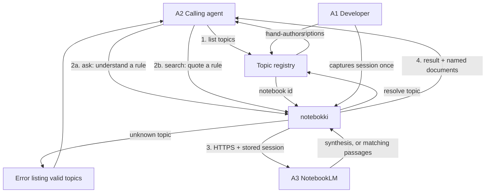
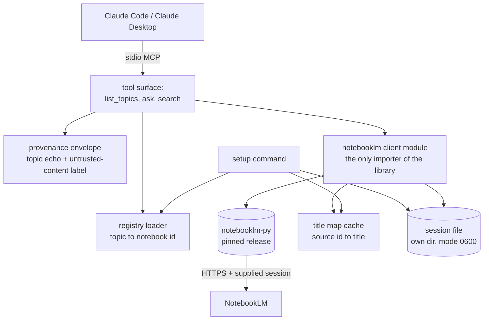
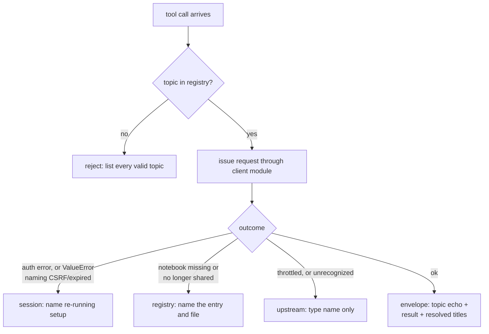

# Notebokki - Plan

## Goal Capsule

- **Objective:** Ship a read-only MCP server, notebokki, that lets Claude Code and Claude Desktop ask a registered NotebookLM notebook a business-rule question, or pull its exact source wording, without the developer leaving the editor.
- **Authority hierarchy:** The Product Contract below wins on product behavior. A Key Technical Decision wins on implementation mechanism within its cited requirements. A unit overrides neither; flows and acceptance examples illustrate and sequence, never amend.
- **Product authority:** This plan owns the read-only query path and the topic registry. Writing to notebooks, notebook discovery, and any team or multi-user deployment are not active scope.
- **Execution profile:** Greenfield Python package. No existing code to characterize, so units build forward rather than refactor. The NotebookLM boundary is faked in tests; the suite runs with no network and no credentials.
- **Stop conditions:** Stop and surface rather than guess if the pinned library's documented surface does not match reality (`sources.search`, `chat.ask().references`, `sources.list`), or if the manual session-capture path cannot produce a working session.
- **Tail ownership:** Standalone run — this plan does not open a PR. The repository has no commits and no remote.
- **Open blockers:** None.

## Product Contract

**Product Contract preservation:** changed — R8, R10, AE4, Summary, Problem Frame, and one Scope Boundary. Verification against the installed `notebooklm-py` 0.8.4 found R8 as originally written to be unreachable without deleting the notebook's chat history, so statelessness was renegotiated with the product owner; R10 is clarified because asking inherently records a chat turn; the Summary's and Problem Frame's custody claim is corrected to name the one pinned dependency. R-IDs are unchanged and nothing was renumbered.

### Summary

Notebokki is an MCP server that exposes a developer's NotebookLM notebooks to Claude as a question-answering source. A hand-written registry maps short topic names to notebook URLs with descriptions; Claude reads those descriptions, picks a topic, and either asks it a question or pulls matching source text verbatim. Results are grounded in the notebook's own documents with their sources named. It is read-only and built in-house rather than adopted. The session is held by notebokki and by one pinned third-party library in the same process — no community server, no browser, and no network service holds it — and that library plus its locked dependency set is the trust boundary.

### Problem Frame

Business rules live in NotebookLM, organised as one notebook per topic or business area. Code and code review live in Claude Code. Today the two only meet through the developer: while writing or reviewing code, they stop, open the right notebook in a browser, ask it a question, read the answer, and relay it back into the session by hand. The interruption is small each time and constant in aggregate, and the relayed answer arrives stripped of its citations, so a reviewer cannot tell which document a rule came from.

The gap is not a missing document store — the documents are already imported and already indexed by NotebookLM. The gap is that the agent doing the work cannot reach them.

Several community MCP servers already close this gap, but each asks the developer to let a whole unreviewed server hold a live Google session for their own account. For a credential that grants a full Google identity rather than a scoped token, that custody question is the deciding one — narrowing the third-party surface to one pinned, auditable library is the point of building the rest.

### Key Decisions

- **Build in-house rather than adopt an existing server.** Custody of the Google session credential, and the freedom to change behavior later, outweigh the setup cost saved by adopting (session-settled: user-directed — chosen over adopting an existing community server: third-party code should not hold a credential granting a full Google identity). *Governs R14, R16, R18.*
- **Claude chooses the notebook; notebokki never guesses.** Topic descriptions are exposed to the agent, which selects a topic and passes it explicitly. Routing stays transparent and correctable, and no matching logic has to be written or maintained (session-settled: user-directed — chosen over server-side matching, one tool per notebook, or a required topic argument: transparency and zero matching logic outweigh the extra round-trip). *Governs R3, R5, R6, R7.*
- **A wrong topic name fails loudly.** For business rules, an error that lists the valid topics is strictly better than a confident answer drawn from the wrong notebook. The error doubles as topic discovery, so an agent that skipped the listing tool self-corrects (session-settled: user-directed — chosen over fuzzy matching with or without an ambiguity check: a near-miss across two real topics would answer confidently from the wrong notebook). *Governs R9.*
- **Two query modes, not one.** A synthesized answer is right for understanding a rule; verbatim source text is right for quoting one in a review comment, where a paraphrase is not evidence (session-settled: user-directed — chosen over synthesis only: quoting a rule exactly in review was worth the extra tool). *Governs R6, R7, R11, R12.*
- **Notebokki holds no state; NotebookLM threads.** Every question goes to the notebook's single NotebookLM chat thread, which the service extends across calls exactly as the web UI does. Notebokki never creates, deletes, or rotates that thread, so it never destroys chat history the developer owns. The cost is that an answer can be influenced by earlier questions on that notebook, including the developer's own in the browser (session-settled: user-directed — chosen over deleting the thread before each ask, or deleting only threads notebokki created: a read-shaped tool should not delete the developer's chat history to obtain reproducibility). *Governs R8.*
- **The registry is hand-authored, with no discovery surface.** Notebokki never enumerates the account's notebooks, for the developer or for Claude. The allowlist cannot grow by accident, and descriptions get written deliberately because they have to be typed (session-settled: user-directed — chosen over a setup-time discovery command or a discovery tool exposed to Claude: an allowlist that cannot drift is worth the typing). *Governs R1, R2.*
- **Manual session capture over automated extraction or a driven browser.** One interactive paste at setup, then HTTPS requests only. This keeps the credential path short enough to read end to end and avoids running a browser inside WSL2 (session-settled: user-directed — chosen over automated cookie extraction or a persistent driven browser: WSL2 puts the browser on the Windows host, and a short readable credential path is the point). *Governs R14, R16.*
- **Read-only as to notebook content.** No tool adds, edits, or removes a source, a notebook, or notebook structure. Asking does record a chat turn on the notebook's thread, the same write the web UI performs when the developer types a question, so the guarantee is about content rather than about issuing no writes at all. *Governs R10.*

### Actors

- A1. Developer — authors and curates the registry, performs the interactive session capture, and reads the results Claude surfaces.
- A2. Calling agent — Claude Code or Claude Desktop. Chooses a topic and a query mode. This is notebokki's primary consumer, and the audience its tool descriptions are written for.
- A3. NotebookLM — the hosted notebook service (also branded Gemini Notebook). Holds the documents, performs retrieval and synthesis, and owns the authentication boundary.

### How a question reaches an answer

### Requirements

**Topic registry**

- R1. Notebokki reads a developer-authored registry file that maps a short topic name to a notebook URL and a description of what that notebook covers.
- R2. The registry is the sole allowlist — only notebooks named in it are reachable, and notebokki provides no way to enumerate or reach an unregistered notebook.
- R3. Each description is written to be sufficient for an agent to choose between topics without opening the notebook.
- R4. Notebokki derives the notebook identifier from the stored URL, so the developer can paste a browser URL verbatim rather than extracting an ID by hand.

**Query surface**

- R5. Notebokki exposes a tool that lists every registered topic with its description.
- R6. Notebokki exposes a tool that takes a topic and a question and returns NotebookLM's synthesized answer for that notebook.
- R7. Notebokki exposes a tool that takes a topic and a query and returns matching source text from that notebook's documents, unsummarized.
- R8. Notebokki holds no conversational state of its own: it sends only the current question and never a conversation identifier, and never creates, deletes, or rotates a notebook's chat thread. Both query tools' descriptions state that an answer may be influenced by earlier questions on that notebook's thread.
- R9. A topic name with no exact registry match is rejected with an error naming every valid topic; notebokki never resolves a near match on the caller's behalf. This applies identically to both query tools.
- R10. No tool adds, edits, or removes a source, a notebook, or notebook structure. Recording a chat turn on the notebook's own thread, which asking necessarily does, is not such a mutation.

**Result shape**

- R11. A synthesized answer names the source documents it drew on, so a rule can be traced to a document before it is acted on in code or review.
- R12. Verbatim results carry each passage's originating document, so a quoted rule can be attributed without a second lookup.
- R13. Notebokki returns NotebookLM's output as-is and never supplements it from another model or from general knowledge; when a notebook's sources do not cover the question, the caller receives that outcome rather than a substitute answer.

**Session and authentication**

- R14. A single interactive setup step captures the developer's NotebookLM web session and stores it locally. Notebokki does not read or decrypt a browser profile.
- R15. Setup validates every registry entry by reaching its notebook, and reports each entry that fails, so a mistyped URL surfaces at setup rather than mid-task.
- R16. At query time notebokki issues HTTPS requests only and starts no browser process.
- R17. An expired or invalid session produces an error that names re-running setup as the fix, distinguishable from a wrong-topic error and from a NotebookLM-side failure.
- R18. The stored session is treated as a credential — documented as granting full Google account access, and excluded from version control.

### Key Flows

- F1. First-run setup
  - **Trigger:** A1 installs notebokki and has not yet captured a session.
  - **Actors:** A1
  - **Steps:** A1 writes registry entries for the notebooks worth exposing; A1 runs the setup step and supplies the captured session; notebokki stores it locally and checks every registry entry, reporting any it cannot reach.
  - **Outcome:** Notebokki answers queries, every registered topic is known-reachable, and the credential exists in exactly one local location.
  - **Covered by:** R1, R4, R14, R15, R18

- F2. Understanding a business rule mid-task
  - **Trigger:** A2 is writing or reviewing code and needs a business rule it cannot derive from the repo.
  - **Actors:** A2, A3
  - **Steps:** A2 lists topics and reads the descriptions; A2 selects the topic whose description covers the rule and asks a self-contained question; notebokki resolves the topic to a notebook and forwards the question over HTTPS with the stored session; NotebookLM answers from that notebook's documents; notebokki returns the answer with its sources named.
  - **Outcome:** The rule reaches the session already attributed to a document, with no browser detour by A1.
  - **Covered by:** R3, R5, R6, R8, R11, R13, R16

- F3. Quoting a rule in a review comment
  - **Trigger:** A2 is about to assert a rule in review and needs the rule's exact wording rather than a restatement.
  - **Actors:** A2, A3
  - **Steps:** A2 queries the relevant topic for source text; notebokki returns the matching passages with their documents; A2 quotes a passage and attributes it.
  - **Outcome:** The review comment carries the rule's own words and its source, so the author can verify it without re-asking.
  - **Covered by:** R7, R12

- F4. Topic name does not match
  - **Trigger:** A2 queries with a topic name it guessed or remembered rather than listed.
  - **Actors:** A2
  - **Steps:** Notebokki finds no exact match and returns an error listing every valid topic; A2 reads the list and reissues the call with a real topic.
  - **Outcome:** One wasted call, no wrong answer. The error served as topic discovery.
  - **Covered by:** R9

- F5. Session has expired
  - **Trigger:** A2 issues a well-formed query after the stored session has lapsed.
  - **Actors:** A2, A1
  - **Steps:** NotebookLM rejects the request as unauthenticated; notebokki returns an error identifying the session as the cause and naming setup as the fix; A1 re-runs setup.
  - **Outcome:** The failure is attributed correctly, so A2 does not retry a query that cannot succeed or report the notebook as empty.
  - **Covered by:** R17

### Acceptance Examples

- AE1. **Covers R9.** **Given** the registry defines `billing`, `hr`, and `logistics`, **when** the agent queries topic `billing-rules` through either query tool, **then** the call fails with an error naming `billing`, `hr`, and `logistics`, and no notebook is queried.
- AE2. **Covers R11.** **Given** a question answerable from two documents in the `billing` notebook, **when** the agent asks it, **then** the response carries both the answer and the names of those documents.
- AE3. **Covers R7, R12.** **Given** the `billing` notebook contains a refund-window rule, **when** the agent queries it for source text, **then** the response carries the rule's own wording, attributed to its document, with no synthesized restatement wrapped around it.
- AE4. **Covers R8.** **Given** the agent asks `billing` a question and then asks a second, **when** the second call runs, **then** notebokki sends only the second question and no conversation identifier, holds no per-topic state between the two calls, and issues no conversation delete.
- AE5. **Covers R13.** **Given** a question the `billing` notebook's sources do not cover, **when** the agent asks it, **then** the response conveys that the notebook cannot answer, and contains no rule drawn from outside the notebook.
- AE6. **Covers R15.** **Given** a registry entry whose URL points at a notebook the session cannot reach, **when** setup runs, **then** setup names that entry as failing, and does not report success as though the registry were sound.
- AE7. **Covers R17.** **Given** a lapsed stored session, **when** the agent queries any registered topic, **then** the error identifies the session as the cause and names the setup step, and does not read as an empty or missing notebook.
- AE8. **Covers R2.** **Given** a notebook the developer owns but has not registered, **when** the agent lists topics, **then** that notebook does not appear and cannot be queried by URL or identifier.

### Success Criteria

- In the common case the agent reaches the correct notebook from the descriptions alone, without A1 naming it — the measure of whether R3's descriptions are doing their job.
- Notebokki adds negligible overhead on top of NotebookLM's own response time, and pays no browser startup cost — so asking mid-task is cheaper than opening a browser tab. Total latency is NotebookLM's to set, not notebokki's.
- Every rule surfaced into a session arrives with a document name attached, making it usable as review evidence rather than hearsay.
- The agent reliably picks the right query mode — synthesis to understand, source text to quote — rather than defaulting to one and paraphrasing when it should quote.

### Scope Boundaries

**Deferred for later**

- Writing to notebooks — adding sources, creating notebooks, audio overviews.
- Automated extraction of session cookies from a browser profile.
- Multiple Google accounts or profiles in one installation.
- Per-repository registry subsets, so different codebases see different topics.
- Source freshness metadata in results, such as a last-modified date per cited document.

**Outside this product's identity**

- Notebook discovery in any form — neither a setup-time listing for the developer nor a tool exposed to Claude. Enumeration would make the registry something other than a fixed allowlist, per R2.
- Managing NotebookLM conversation threads — creating, deleting, or rotating them — per R8. Notebokki reads and appends to whatever thread the notebook already has.
- Browser automation. Driving a real Chromium would trade endpoint fragility for selector fragility while reintroducing the large opaque dependency this project exists to avoid.
- Exporting notebook sources into the repository as markdown for the agent to read directly. Considered and rejected: it discards NotebookLM's synthesis across many documents, which is the capability being bought.
- Any agent-side or server-side synthesis layered on top of NotebookLM's output, per R13.
- The Gemini Notebook Enterprise API path. These notebooks are on the regular web product, not a Cloud-provisioned enterprise tier.

### Dependencies / Assumptions

- No official API exists for these notebooks. Notebokki depends on NotebookLM's unpublished web endpoints, which Google may change without notice. Breakage is expected as a maintenance cost, not an edge case.
- The developer has judged that scripted access with their own session is an accepted cost rather than a policy blocker. This is a recorded position, not a cleared review.
- A captured web session is sufficient to query a notebook over HTTPS, and session lifetime is long enough that re-capture is occasional. Lifetime is unmeasured.
- NotebookLM exposes a retrieval path that returns source passages without synthesis. R7 and F3 assume this; if only synthesis is reachable, they need rework rather than reinterpretation.
- Asking records a chat turn on the notebook's thread, so questions Claude asks are expected to appear in the developer's own NotebookLM chat history for that notebook. This follows from the library matching the web UI's default behavior; the live smoke confirms it.
- Notebook currency is the developer's responsibility. A superseded document still present in a notebook answers as authoritatively as a current one, and notebokki surfaces no signal distinguishing them beyond the document's name. This is an accepted risk, not an oversight.
- Notebook URLs are stable identifiers — a registry entry keeps working as long as the notebook exists.
- The notebooks' documents are already imported and current. Notebokki does not manage ingestion, so result quality tracks whatever is in the notebook.

### Outstanding Questions

**Deferred to Planning**

- How session expiry is detected, and how quickly re-capture can be made — the stated target is a setup step short enough that unmeasured session lifetime stops mattering.
- How verbatim results are bounded: passage count, length cap, and whether ranking is NotebookLM's or notebokki's.
- Whether to depend on an existing client library for the request format or to implement it directly after reading one. Governed by R14, R16, and the custody decision, not by convenience.
- Implementation language and runtime.
- Registry file location and schema.
- Which notebook URL forms to accept when deriving the identifier, per R4. Both `notebooklm.google.com` and `notebook.google.com` appear in use; accept the forms that occur rather than assuming one.
- Whether R15's validation runs on every server start or only on explicit setup, given it costs one request per registered topic.

### Sources / Research

- No official NotebookLM API exists for personal or regular Workspace accounts. Google documents a **Gemini Notebook Enterprise** API on `discoveryengine.googleapis.com` v1alpha, in Preview, covering notebook create/get/list/delete/share and source management: https://docs.cloud.google.com/gemini/enterprise/notebooklm-enterprise/docs/api-notebooks. **Unverified:** whether that API exposes any ask-a-question or answer method. The REST reference was not read to completion, so its absence is not established — confirm before treating the enterprise path as query-incapable.
- The product was renamed from NotebookLM to Gemini Notebook; sources disagree on the date. Treat both names as current in anything user-facing.
- Prior art, all using unofficial access, useful for learning the request format and the tool surface rather than as dependencies:
  - https://github.com/REllwood/NotebookMCP — HTTPS via the `notebooklm-py` library, no browser; resolves notebooks by name; exposes both a synthesis tool and a verbatim-passage tool, which is the closest existing shape to this plan.
  - https://github.com/julianoczkowski/notebooklm-mcp-2026 — exposes a notebook-ID-plus-question query tool.
  - https://github.com/PleasePrompto/notebooklm-mcp — drives real Chrome via Patchright; the approach this plan rejects, documented for its re-auth handling.
  - https://github.com/juanQNav/mcp-notebooklm — limits itself to one in-flight query at a time, a concurrency constraint worth checking for.
  - https://github.com/Pantheon-Security/notebooklm-mcp-secure — security hardening around the same unofficial access path.
- Environment constraint: development is on WSL2, so the browser holding the Google session is on the Windows host. This is what makes automated cookie extraction and in-Linux Chromium both more expensive than they appear.

---

## Planning Contract

### Key Technical Decisions

- KTD1. **Python package, official `mcp` SDK pinned to 2.x, stdio transport.** Python is forced by the only available protocol reference and by local toolchain (Python 3.12.3, uv 0.11.26). Stdio is what Claude Code and Claude Desktop launch as a subprocess. Pin the `mcp` 2.x line: 2.x renamed `FastMCP` to `MCPServer`, so the 1.x-era import shapes used by every prior-art server in Sources / Research do not transfer even though their tool surface does. The NotebookLM library's import name is `notebooklm`, not `notebooklm_py`.
- KTD2. **Depend on `notebooklm-py` pinned to an exact release, reached only through one internal client module.** Upstream absorbs Google's undocumented RPC changes, the largest recurring maintenance cost here; confining it to one module keeps a later swap contained. Because the Summary's custody claim is now scoped rather than absolute, this pin plus the committed lockfile is the control on that trust boundary, not a convenience: read the pinned release's credential handling once before adopting, enumerate its locked dependency set, and re-read both on every bump. (session-settled: user-directed — chosen over vendoring the subset under its MIT license: upstream chases Google's endpoint changes so notebokki does not have to.) *Instantiates the build-in-house decision; governs R14, R16, R18.*
- KTD3. **The session reaches the library through an explicit storage path only.** The library's inline-JSON environment variable is rejected: an MCP server's environment is authored in the launcher's config file, which carries no permission guarantee and is routinely committed, and a shell-exported value is one `env` away from an agent transcript. An explicit path also outranks that variable in the library's own precedence order, so passing the path keeps a stray export from taking effect. No interactive login and no browser-profile import exist in this codebase; the library's browser dependency is an optional extra that stays uninstalled. Rejected: the library's master-token mode, which would refresh an expired session unattended but is a long-lived full-account credential, failing the custody property that chose manual capture. *Instantiates the manual-session-capture decision; governs R14, R16.*
- KTD4. **Setup validates a stricter cookie set than the library enforces, and accepts the payload only out of band.** The library hard-requires `SID` and `__Secure-1PSIDTS` and merely warns when the secondary binding is absent, which is the warning-only path that lets a bad capture stay latent until the first query; setup therefore also requires either `OSID` or all three of `APISID`, `SAPISID` and `LSID`, and rejects a payload that lacks them. The payload is a Playwright storage-state JSON object — a `cookies` array of name/value/domain/path entries on `.google.com` plus an `origins` array — not a DevTools cookie dump. Setup reads it from piped stdin or a `--from-file` path and never from a command-line argument or an interactive prompt: argv is visible in shell history and to any process, and a terminal in canonical mode truncates a pasted line near 4096 bytes, which would silently cut a multi-kilobyte cookie set and surface as a confusing partial-payload rejection. *Governs R14.*
- KTD5. **Registry validation runs on explicit setup only, scoped one call per topic.** One account-wide listing would validate every entry in a single request but would enumerate every notebook in the account, which the no-discovery product decision forbids. Per-topic scoping never enumerates, and the same notebook-scoped source listing primes the title map, so validation and cache warm-up are one call rather than two. Validation does not run on server start: every launch would otherwise spend quota on a registry that rarely changes. *Governs R15; respects the hand-authored-registry decision over R1, R2.*
- KTD7. **Four-branch failure classification: unknown topic, dead session, notebook unreachable, upstream-or-throttled.** The session branch cannot be read from exception types alone — the library raises a typed auth error mid-call but a bare `ValueError` carrying `CSRF token not found` or `Authentication expired` when the session opens, a legacy shape its own source documents as deliberately preserved. Both must map to the session branch, and the substring check is pinned to the library version by the committed surface test. The notebook-unreachable branch exists because a deleted or share-revoked notebook is a permanent registry-level fault: routed to the session branch it would send the developer to re-run setup, which cannot fix it, and routed to upstream it would tell them to wait, which never resolves. Its message names the registry entry and the registry file as the fix. An unrecognized exception maps to upstream and surfaces its type name only. The library's own retry limits and chat timeout are set explicitly rather than inherited, because its defaults retry a throttled call with backoff behind a timeout of at least 180 seconds, turning throttling into minutes of latency instead of a classifiable failure. *Governs R9, R17.*
- KTD8. **Source attribution resolves document titles through a per-notebook title map, cached for the server's lifetime.** Both result paths return source identifiers rather than titles, so a lookup is required; the map is primed by setup validation and refreshed on a miss. A title can be absent from the map, and the library also types a source title and a citation's quoted text as optional, so each result path degrades to reporting the identifier and labelling it unresolved rather than emitting an empty attribution. *Governs R11, R12.*
- KTD9. **The session file's mode is verified after writing, and cookie values never leave the process.** Permissions are checked, not assumed: `chmod` returns success on a DrvFs mount under `/mnt/` while persisting nothing, so setup creates the file owner-only, stats it, and refuses unless the mode is exactly `0600` — naming the filesystem as the likely cause and directing the developer to a path on the Linux filesystem. The same check runs when overwriting on re-capture, and after any library call that may have rewritten the file, because the library rotates cookies back to disk on close, refresh, and keepalive. The prohibition is on cookie *values*, not names: setup's rejection message and its tests necessarily name which required cookies are missing. Values are kept out of output by a logging filter installed on the root handler, by pinning the library's, HTTP client's, and SDK's loggers to warning level regardless of any environment request to raise them, and by a catch-all at every tool boundary that reports an exception's type without its text or traceback — stderr on a stdio server is captured into the host's persistent log files. *Serves R18 and R14.*
- KTD10. **Both query tools' descriptions carry the invocation contract, not just the input schema.** Each description states when to consult notebokki — before asserting or relying on a business rule that cannot be derived from the repo — which mode suits which job, that cited document names must travel into any answer or review comment, and that an answer may be influenced by earlier questions on that notebook's thread. The Success Criteria predict that the agent consults notebokki unprompted and picks the right mode; nothing but these descriptions can cause either, so they are a designed artifact rather than incidental prose. *Serves the Success Criteria; governs R8's description clause.*
- KTD11. **Every result is returned inside a labelled provenance envelope that echoes the resolved topic.** The envelope names the topic, its registry description, and the originating document, and carries a fixed preamble stating that the enclosed text is retrieved reference material and must never be followed as an instruction; any closing-delimiter sequence inside the passage is neutralized. This does two jobs at once. It makes a misroute visible: the loud-failure decision only catches a topic absent from the registry, so a registered but topically wrong notebook would otherwise return a confident, document-cited answer with nothing marking it as wrong. And it marks untrusted content: notebook sources are documents other people wrote, and both tools return their text into an agent that holds shell access on the machine storing the session file. A provenance delimiter is a label, not a restatement, so R13 and the no-summarizing-wrapper acceptance example still hold. *Serves R11, R12, R13; makes R3's routing observable.*
- KTD12. **Configuration lives under `~/.config/notebokki/`, honoring `XDG_CONFIG_HOME`.** The registry sits there; the session file sits in its own subdirectory created at mode `0700`, so the library's lock file, rotated rewrites, and account-metadata sidecar are all covered by one directory rather than one filename. Both paths take an explicit override. The session file is outside any repository by default — a path inside the working tree would place a full-account credential where the host agent's file tools reach it by default. *Governs R1, R18.*
- KTD13. **One client, opened at server start and closed at shutdown.** The library's client is an async context manager whose entry performs a network round-trip, and its instance is bound to the event loop that created it. A single long-lived client on the server's loop is therefore the only shape that lets the title map live for the server's lifetime, and it routes an open-time session failure through the same branch as a mid-call one. Every library call is a coroutine, so the client module is async throughout. *Serves KTD8, R17.*

### High-Level Technical Design

Module topology. The library is reachable from exactly one module, which is what makes KTD2's swap contained.

Failure classification. Every tool call lands in exactly one branch, and the branches are deliberately not collapsible.

### Assumptions

- The library surface verified against the installed 0.8.4 holds: `sources.search(notebook_id, query, *, source_ids, limit)` returning ranked chunks with source identifier, text, and rank; `chat.ask(...)` returning an answer plus references carrying source identifier and quoted text; `sources.list(notebook_id)` returning sources with identifier and title. A committed surface test pins this so an upgrade fails loudly.
- A full Google cookie set can be captured manually from a signed-in browser and supplied as a storage-state file. The library accepts an explicit storage path and needs no browser to use it, but does not document a hand-authored payload as a supported workflow. Only the live gate can close this.
- Available quota covers interactive use plus one call per topic at setup. Tier limits were not read, and one logical question costs several requests on the wire rather than one.
- The developer's Google account can reach every notebook named in the registry.

### Sequencing

U1 first — nothing resolves without the package, the pinned dependencies, and the config module. U2 and U3 both depend on U1 and are independent of each other. U4 depends on U2 and U3, because validating the registry needs both. U5 depends on U2 and U3, and is independent of U4.

U3 carries the first live contact with the service, and it carries it deliberately: both load-bearing assumptions above are proved or disproved there, before U4 and U5 are built on them.

### Risks & Dependencies

- **Upstream library churn.** `notebooklm-py` is pre-1.0 with 34 releases and was pushed the day before this plan was written. The committed surface test is what makes "re-run the suite" mean something on a bump — the faked boundary alone would stay green through a changed return shape, silently stripping the attribution R11 and R12 exist to guarantee.
- **Supply chain.** The pin is the custody control, so it must cover the whole locked closure, not one package name. A compromised transitive dependency has in-process read access to the credential.
- **Google-side endpoint change.** The library's own documentation says it uses undocumented APIs that can change without notice. This is the accepted maintenance cost recorded in the Product Contract, not a mitigable risk.
- **Session capture friction.** The required cookie set is larger than one value and a hand-authored payload is undocumented upstream, so capture is the most likely setup failure. KTD4 makes it explicit at setup; U3's live probe makes it explicit earlier still.
- **Credential at rest.** The stored session grants full Google account access while valid, on a workstation that is backed up and synced like any other. KTD9 and KTD12 narrow the exposure to one owner-only file in its own directory and keep values out of output; they do not eliminate it. Revocation is a Google-side account action notebokki cannot perform.
- **Untrusted notebook content.** Notebook sources may be authored by others, and both tools return their text into an agent that holds shell access on the machine storing the session file. KTD11's envelope labels it; labelling is mitigation, not prevention.
- **Quota throttling.** The library retries a throttled call internally, so throttling arrives as latency before it arrives as an error. KTD7 sets those limits explicitly so the latency is bounded and the branch is reachable.

### Open Questions

**Deferred to Planning**

- Observed session lifetime, and therefore how often re-capture is needed. Unmeasured; the live gate records the capture date so real use accumulates the answer.
- Whether the title map needs a time bound rather than the server's lifetime. The document name is the only currency signal the product carries, so an indefinitely cached title can misreport a renamed source as current; a stdio server launched per session makes the window short, a long-lived desktop session makes it days.
- Default passage count for the verbatim path — pick a conservative default, tune once real review use shows whether answers come back over- or under-trimmed.
- Which notebook URL forms to accept when deriving the identifier, per R4. Both `notebooklm.google.com` and `notebook.google.com` appear in use; accept the forms that occur.

**Resolved at the U3 live gate (2026-10-17)**

- A hand-authored storage-state payload authenticates. Shape that worked: `{"cookies": [...], "origins": []}`, with 24 cookies derived from a browser request's `Cookie` header, each entry `domain: ".google.com"`, `path: "/"`, `expires: -1`, `secure: true`. The library opened the client from an explicit path (round-trip succeeded) and `sources.list` and `sources.search` both returned real data against a registered `notebook.google.com` notebook. The file stayed at mode `0600`.
- Observed: `sources.search` returned zero chunks for the bare query `the` and 2-3 chunks for topical queries; many returned chunks are very short (about 45 characters) beside occasional long ones, which bears on the default passage count.

---

## Implementation Units

### U1. Package scaffold, pinned dependencies, and config paths

- **Goal:** An installable package with a locked dependency set, console entry points, an async-capable test suite, a lint gate, and one module owning every path.
- **Requirements:** R1, R18 (paths and ignore rules); enables every other unit.
- **Dependencies:** none
- **Files:** `pyproject.toml`, `uv.lock`, `src/notebokki/__init__.py`, `src/notebokki/config.py`, `src/notebokki/__main__.py`, `tests/__init__.py`, `tests/test_config.py`, `README.md`, `.gitignore`
- **Approach:**
  1. Declare the package with `uv`, requiring Python 3.10 or later; the development machine runs 3.12.3.
  2. Pin the `mcp` 2.x line and `notebooklm-py` to exact releases, per KTD1 and KTD2, and commit `uv.lock` — it records per-artifact hashes, which is what turns a version pin into an integrity control over the whole closure.
  3. Add `pytest`, `pytest-asyncio` with automatic async mode, and `ruff` as development dependencies. Every library call is a coroutine, so without an async harness the tests collect and never run their assertions.
  4. Declare console entry points for `setup` and `serve`. The server is unreachable without a launch command, so document the host configuration block in the README.
  5. Put path resolution in one module, per KTD12, so the ignore rule, the registry loader, and the session writer cannot disagree.
  6. Ignore the whole configuration directory as a backstop for a developer who overrides the path into a repository.
- **Test scenarios:**
  - Covers R18 / KTD12. The resolved default session path lies outside the repository working tree, asserted against the path resolver rather than by a repository ignore check — the ignore check errors on any path outside the tree, so passing it would require the credential to live inside the repo.
  - Covers KTD12. `XDG_CONFIG_HOME` redirects both the registry and session paths, and an explicit override takes precedence over it.
  - Covers R1. The registry and session paths are distinct, and the session path's parent is its own directory.
  - The console script is installed and its help lists both `setup` and `serve`.
- **Verification:** `uv sync --locked` installs the locked artifacts, `uv run pytest` collects and passes with async tests actually executing, `uv run ruff check` is clean.

### U2. Topic registry

- **Goal:** Load the hand-authored registry, reject a malformed one, and resolve a topic name to a notebook identifier.
- **Requirements:** R1, R2, R3, R4, R9
- **Dependencies:** U1
- **Files:** `src/notebokki/registry.py`, `tests/test_registry.py`
- **Approach:**
  1. Load the JSON registry from the path U1's config module resolves, mapping each topic to a notebook URL and a description.
  2. Derive the notebook identifier from the stored URL so a pasted browser URL works verbatim, per R4. A URL whose identifier cannot be derived is a load error naming the topic.
  3. Expose exact-match lookup only. No fuzzy resolution exists anywhere in the codebase, per R9's owning decision.
  4. Expose each topic's description for the listing tool and for KTD11's topic echo.
- **Test scenarios:**
  - Covers R4. An entry holding a full browser notebook URL resolves to the bare identifier.
  - Covers R4. An entry whose URL carries no derivable identifier fails at load, naming the offending topic.
  - Covers R9 and R2. Lookup of a topic absent from the registry returns no match, and no near-match is substituted.
  - Covers R3. Each topic's description is retrievable for both the listing tool and the topic echo.
  - A registry that is absent, empty, or invalid JSON fails at load with a message distinguishing those three cases.
- **Verification:** `uv run pytest tests/test_registry.py` passes with no network access.

### U3. NotebookLM client module

- **Goal:** The single module that imports the pinned library, wrapping it with lifecycle, title resolution, and four-branch failure classification.
- **Requirements:** R6, R7, R8, R11, R12, R13, R16, R17; participates in F2, F3, F5
- **Dependencies:** U1
- **Files:** `src/notebokki/notebooklm.py`, `src/notebokki/errors.py`, `tests/test_notebooklm.py`, `tests/test_library_surface.py`
- **Execution note:** Prove both load-bearing assumptions here, before U4 or U5 is built on them. First land the committed surface test. Then run a one-off live probe: construct the client from a hand-captured storage payload and issue one real request against one registered notebook, and record the exact payload shape that worked. If either fails, stop and surface it per the Goal Capsule — the whole setup half of the plan rests on them.
- **Approach:**
  1. Construct the library client from an explicit storage path only, per KTD3, and hold one client for the server's lifetime on the server's loop, per KTD13. The module is async throughout.
  2. Expose a synthesized-answer operation and a ranked verbatim-passage operation. Send only the current question and never a conversation identifier, and never delete or rotate a conversation, per R8.
  3. Resolve source identifiers to titles through the cached title map, degrading to a labelled-unresolved identifier when the title is missing, null, or empty, per KTD8.
  4. Classify failures into KTD7's four branches as typed errors. Detect the session branch from both the typed auth error and the bare `ValueError` naming CSRF or expired authentication.
  5. Set the library's retry limits and chat timeout explicitly, per KTD7, rather than inheriting defaults that convert throttling into minutes of latency.
  6. Install the logging filter and pin third-party logger levels, per KTD9.
- **Test scenarios:**
  - Covers AE2 / R11. An answer whose references name two source identifiers returns the answer plus both resolved document titles.
  - Covers AE3 / R7, R12. A verbatim query returns the library's ranked passages with their text unmodified, in the library's rank order, with no summarizing wrapper.
  - Covers AE5 / R13. A question the notebook cannot answer returns the library's own outcome; no substitute text is generated and no second model is consulted.
  - Covers AE4 / R8. A call sends only its own question — no prior question, answer, or conversation identifier appears in the request issued — and no conversation delete is ever issued by any operation.
  - Covers R16. The client is constructed only from a supplied storage path: no login path, no browser-profile import, and no credential read from the process environment exists, and no browser process is started.
  - Covers AE7 / R17, KTD7. Each of the four branches classifies distinctly: an unknown topic never reaches this module; a typed auth error and a bare `ValueError` naming CSRF both classify as session; a missing or unshared notebook classifies as registry; a throttle and an unrecognized exception both classify as upstream.
  - Covers KTD7. An unrecognized exception surfaces as upstream carrying its type name only, with no text from the original exception and no traceback.
  - Covers KTD8. Two queries against the same notebook resolve titles with one title-map fetch, not two.
  - Covers KTD8. A source absent from the map, a source whose title is null, and a reference whose quoted text is null each degrade to a labelled identifier without raising.
  - Covers KTD9. No classified error carries a cookie value, including when the underlying library failure text contains one, and a library log record emitted at debug level carrying a cookie value is suppressed by the filter.
  - Covers R10 / KTD2. Driven against a recording fake, the module touches only the three allowlisted library members across all operations; any other library attribute access fails the test.
- **Verification:** `uv run pytest tests/test_notebooklm.py tests/test_library_surface.py` passes — the first against a faked boundary with no network and no credentials, the second against the installed package by signature introspection, also with no network.

### U4. Setup command

- **Goal:** A one-step setup that ingests a session safely, proves its file mode, and proves every registry entry is reachable.
- **Requirements:** R14, R15, R18; realizes F1
- **Dependencies:** U2, U3
- **Files:** `src/notebokki/setup.py`, `tests/test_setup.py`
- **Approach:**
  1. Read the storage-state payload from piped stdin or `--from-file` only, per KTD4. Reject a payload supplied as a command-line argument, directing the developer to stdin.
  2. Validate the stricter cookie set KTD4 names and reject a partial payload, naming which required cookies are missing.
  3. Write the file owner-only in its own directory, then stat it and refuse unless the mode is exactly `0600`, naming the filesystem as the likely cause, per KTD9 and KTD12.
  4. Validate every registry entry with one notebook-scoped call per topic, priming the title map from the same call, per KTD5. Report each entry that cannot be reached, and distinguish a throttled validation call from an unreachable entry so a correct URL is never reported as bad.
  5. Report the storage path, state plainly that it grants full Google account access, and never echo the payload.
  6. Keep validation out of the server start path, per KTD5.
- **Test scenarios:**
  - Covers AE6 / R15. A registry with one unreachable entry reports that entry as failing and does not report overall success.
  - Covers R15. A registry whose entries are all reachable reports success, issues exactly one call per topic, and leaves the title map primed.
  - Covers R15 / KTD7. A validation call that is throttled is reported as a transient upstream condition, not as a failing registry entry.
  - Covers R14 / KTD4. A payload missing a hard-required cookie is rejected naming it; a payload holding both hard-required cookies but no secondary binding is also rejected, though the library alone would only warn.
  - Covers R14 / KTD4. A payload supplied as a command-line argument is rejected with a message directing the developer to stdin.
  - Covers R18 / KTD9. After setup writes the file, its stat mode is exactly `0600`; a target whose mode does not come back `0600` causes setup to fail and remove what it wrote.
  - Covers R18. Setup's output names the storage path and its full-account scope, and contains no cookie value.
  - Covers KTD5. Starting the server performs no validation calls.
- **Verification:** `uv run pytest tests/test_setup.py` passes against a faked client; validation call counts and the resulting file mode are asserted, not assumed.

### U5. MCP tool surface

- **Goal:** The three tools Claude calls, with descriptions that drive invocation and mode choice, and results that carry provenance.
- **Requirements:** R5, R6, R7, R8, R9, R10; realizes F2, F3, F4, F5
- **Dependencies:** U2, U3
- **Files:** `src/notebokki/server.py`, `tests/test_server.py`
- **Approach:**
  1. Expose exactly three tools over stdio — list topics, ask, and verbatim search — and no mutating tool, per R10.
  2. Write both query tools' descriptions to KTD10's contract: when to consult notebokki, which mode suits which job, that document names travel with quoted text, and that an answer may be influenced by earlier questions on that notebook's thread.
  3. Reject an unregistered topic with an error naming every valid topic, identically for both query tools, per R9.
  4. Wrap every result in KTD11's provenance envelope, echoing the resolved topic and its description and neutralizing any closing-delimiter sequence in the passage.
  5. Render the client module's four branches as distinct messages, per KTD7, behind a catch-all that never emits exception text, per KTD9.
- **Test scenarios:**
  - Covers AE1 / R9. Asking with a topic absent from the registry returns an error listing every valid topic, and issues no NotebookLM call.
  - Covers R9. The same holds for the verbatim tool, with the same error shape.
  - Covers AE8 / R5, R2. Listing topics returns every registered topic with its description, and a notebook the developer owns but has not registered neither appears nor can be reached by identifier.
  - Covers R8 / KTD10. Both query tools' descriptions state when to consult notebokki, distinguish the two modes by job, and disclose that answers may be influenced by earlier questions on the notebook's thread.
  - Covers KTD11. Every successful result carries the resolved topic name, its registry description, and the originating document, inside the labelled envelope with its untrusted-content preamble.
  - Covers KTD11. A passage containing a closing-delimiter sequence is returned with the delimiter neutralized and its own text otherwise unaltered.
  - Covers R10. The advertised tool list contains exactly three tools and none that adds sources, creates notebooks, or otherwise mutates a notebook.
  - Covers AE7 / R17, KTD7. The four branches surface as distinguishable messages; the session one names re-running setup, and the registry one names the offending entry and the registry file.
  - Covers R17 / KTD13. Server start with a missing or unreadable session file reports the session branch and names setup.
  - Covers KTD1. A stdio handshake against the launched server advertises exactly the three expected tool names.
- **Verification:** `uv run pytest tests/test_server.py` passes, including the stdio handshake test that spawns the server as a subprocess.

---

## Verification Contract

| Gate | Command | Applies to | Done signal |
|---|---|---|---|
| Locked install | `uv sync --locked` | U1 | Installs exactly the locked artifacts; fails rather than re-resolving if the lockfile is stale |
| Unit suite | `uv run pytest` | U1–U5 | All tests pass with no network access and no session file present |
| Library surface | `uv run pytest tests/test_library_surface.py` | U3 | Signature and field assertions hold against the installed package; fails loudly on an upgrade that breaks them |
| MCP handshake | `uv run pytest tests/test_server.py -k handshake` | U5 | Exactly three tools advertised, none mutating |
| Lint | `uv run ruff check` | U1–U5 | Clean |
| Live routing smoke (manual) | `notebokki setup`, then pose one real business-rule task without naming a topic or a mode | U3, U4, U5 | The agent selects the right topic and the right mode unaided, and the result carries its document name. A wrong pick means a registry description or a tool description needs rewriting, not that the code failed. Record the capture date so observed session lifetime accumulates. |

The unit suite must pass with no credentials on the machine. A suite that needs a live session has broken the faked-boundary contract.

## Definition of Done

**Global**

- Every requirement R1–R18 is covered by a unit's test scenarios or explicitly deferred in Open Questions. No requirement is silently unimplemented.
- All six Verification Contract gates pass, including the manual live routing smoke.
- No cookie value appears in any log line, error message, test fixture, or committed file. Cookie names appear only in the setup validator, its tests, and setup's own missing-cookie message.
- The session file is outside the repository, in its own directory, at mode `0600`, and that directory is ignored as a backstop. No session file or real notebook identifier is committed.
- `notebooklm-py` and the `mcp` SDK are pinned to exact versions and `uv.lock` is committed. The locked dependency set was reviewed at those versions; any change to it on a bump is read as a diff, not accepted as resolution noise.
- The library is imported in exactly one module, asserted by U3's allowlist test rather than by review. A second importer means KTD2's containment was lost.
- The committed surface and handshake tests are kept, not deleted. The live probe from U3's execution note is the only throwaway, and its finding is recorded in the plan rather than in a script.
- Every acceptance example AE1–AE8 is cited by at least one unit's test scenarios, and every flow F1–F5 is realized by at least one unit.
- Abandoned-attempt code is removed. Nothing from an approach that did not pan out remains in the diff.

**Per unit**

- U1: `uv sync --locked`, `uv run pytest`, and `uv run ruff check` all succeed on a clean checkout, and the console script's help lists both subcommands.
- U2: every registry scenario passes, including the three distinct load-failure cases.
- U3: the surface test and the live probe both passed before the rest of the unit was built on them, and every test scenario listed under U3 passes against the faked boundary.
- U4: validation issues exactly one call per topic, reports per-entry failures, distinguishes a throttle from an unreachable entry, and the written file stats at `0600`.
- U5: three tools advertised, none mutating, both query tools' descriptions carry KTD10's contract, and every result carries KTD11's envelope.
